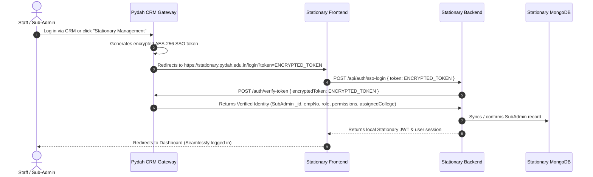

# Stationary Management Portal - SSO & Portal Switcher Integration Guide

This guide provides end-to-end instructions for integrating **Single Sign-On (SSO)** and the **Universal Portal Switcher CDN** into the **Stationary Management** portal.

---

## 🏛️ System Architecture



---

## 🔑 1. Backend Implementation (Stationary Backend)

### Step 1.1: Verify Token Endpoint Details

The CRM Auth Gateway provides the token verification endpoint:

- **Production URL**: `https://crm.pydah.edu.in/api/auth/verify-token`
- **Development URL**: `http://localhost:8000/api/auth/verify-token`
- **Method**: `POST`
- **Headers**: `Content-Type: application/json`

#### Request Payload:
```json
{
  "encryptedToken": "ENCRYPTED_SSO_TOKEN_FROM_QUERY_PARAM"
}
```

#### Successful Response (`200 OK`):
```json
{
  "success": true,
  "valid": true,
  "data": {
    "userId": "67160ad3f5454645ef532b21",
    "name": "john_doe",
    "username": "john_doe",
    "empNo": "2145",
    "role": "Administrator",
    "permissions": [
      "dashboard:full",
      "manage-stock:full",
      "student-management:view",
      "transactions:view"
    ],
    "assignedCollege": "67140e2cf5454645ef531234",
    "assignedBranch": null,
    "email": "john@pydahsoft.in",
    "portalId": "stationary-management"
  }
}
```

---

### Step 1.2: Controller Implementation (`ssoLogin`)

In your Stationary backend (e.g. `backend/controllers/authController.js` or `backend/controllers/subAdminController.js`):

```javascript
const axios = require('axios');
const jwt = require('jsonwebtoken');
const { SubAdmin } = require('../models/subAdminModel');

const CRM_AUTH_URL = process.env.CRM_AUTH_URL || 'https://crm.pydah.edu.in';

/**
 * Handle SSO Login from CRM
 * POST /api/auth/sso-login
 */
exports.ssoLogin = async (req, res) => {
  try {
    const { token } = req.body;

    if (!token) {
      return res.status(400).json({
        success: false,
        message: 'SSO Token is required'
      });
    }

    // 1. Verify encrypted SSO token with CRM Central Gateway
    const crmResponse = await axios.post(`${CRM_AUTH_URL}/api/auth/verify-token`, {
      encryptedToken: token
    });

    if (!crmResponse.data || !crmResponse.data.valid) {
      return res.status(401).json({
        success: false,
        message: 'Invalid or expired SSO token'
      });
    }

    const ssoUser = crmResponse.data.data;

    // 2. Resolve or synchronize SubAdmin in Stationary MongoDB
    let subAdmin = null;

    // A. Match by SubAdmin MongoDB _id
    if (ssoUser.userId) {
      try {
        subAdmin = await SubAdmin.findById(ssoUser.userId);
      } catch (_) {}
    }

    // B. Match by empNo (Foreign key from HRMS)
    if (!subAdmin && ssoUser.empNo) {
      subAdmin = await SubAdmin.findOne({ empNo: ssoUser.empNo });
    }

    // C. Match by name / login ID
    if (!subAdmin && ssoUser.name) {
      subAdmin = await SubAdmin.findOne({ name: ssoUser.name });
    }

    // D. Auto-provision SubAdmin if authorized from HRMS/CRM but not yet created in Stationary DB
    if (!subAdmin) {
      subAdmin = new SubAdmin({
        name: ssoUser.name || ssoUser.username || `emp_${ssoUser.empNo}`,
        empNo: ssoUser.empNo || null,
        password: `sso_${Date.now()}_temp`, // Hashed by subAdminSchema pre-save hook
        role: ssoUser.role || 'Editor',
        permissions: ssoUser.permissions || [],
        assignedCollege: ssoUser.assignedCollege || null,
        assignedBranch: ssoUser.assignedBranch || null
      });
      await subAdmin.save();
    } else {
      // Sync permissions & assigned college if updated from CRM
      let modified = false;
      if (ssoUser.role && subAdmin.role !== ssoUser.role) {
        subAdmin.role = ssoUser.role;
        modified = true;
      }
      if (Array.isArray(ssoUser.permissions) && ssoUser.permissions.length > 0) {
        subAdmin.permissions = ssoUser.permissions;
        modified = true;
      }
      if (ssoUser.assignedCollege && !subAdmin.assignedCollege) {
        subAdmin.assignedCollege = ssoUser.assignedCollege;
        modified = true;
      }
      if (modified) {
        await subAdmin.save();
      }
    }

    // 3. Generate Stationary Application JWT token
    const localToken = jwt.sign(
      {
        id: subAdmin._id,
        name: subAdmin.name,
        empNo: subAdmin.empNo,
        role: subAdmin.role,
        permissions: subAdmin.permissions,
        assignedCollege: subAdmin.assignedCollege
      },
      process.env.JWT_SECRET || 'stationary-secret-key',
      { expiresIn: '8h' }
    );

    return res.status(200).json({
      success: true,
      message: 'SSO Login successful',
      token: localToken,
      user: {
        id: subAdmin._id,
        name: subAdmin.name,
        empNo: subAdmin.empNo,
        role: subAdmin.role,
        permissions: subAdmin.permissions,
        assignedCollege: subAdmin.assignedCollege,
        assignedBranch: subAdmin.assignedBranch
      }
    });

  } catch (error) {
    console.error('[SSO Error]:', error.response?.data || error.message);
    return res.status(500).json({
      success: false,
      message: error.response?.data?.message || 'SSO authentication failed'
    });
  }
};
```

---

## 💻 2. Frontend Implementation (Stationary Frontend)

### Step 2.1: Handling Incoming SSO in `Login.jsx`

In `Stationary/frontend/src/pages/Login.jsx`, add an effect that intercepts `?token=...` from the URL parameters upon page load:

```jsx
import { useEffect, useState } from 'react';
import { useNavigate, useLocation } from 'react-router-dom';
import axios from 'axios';

const Login = () => {
  const navigate = useNavigate();
  const location = useLocation();
  const [isVerifyingSSO, setIsVerifyingSSO] = useState(false);
  const [errorMessage, setErrorMessage] = useState('');

  useEffect(() => {
    const urlParams = new URLSearchParams(location.search);
    const ssoToken = urlParams.get('token');

    if (ssoToken) {
      handleSSOLogin(ssoToken);
    }
  }, [location]);

  const handleSSOLogin = async (ssoToken) => {
    setIsVerifyingSSO(true);
    setErrorMessage('');

    try {
      // 1. Clear any stale session cookies/storage
      localStorage.removeItem('token');
      localStorage.removeItem('user');
      sessionStorage.clear();

      // 2. Call your backend SSO verify endpoint
      const response = await axios.post('/api/auth/sso-login', {
        token: ssoToken
      });

      if (response.data.success) {
        // 3. Store new session
        localStorage.setItem('token', response.data.token);
        localStorage.setItem('user', JSON.stringify(response.data.user));

        // 4. Smooth dismiss for workspace switcher overlay (if opened via switcher)
        if (window.PydahSwitcher?.hideTransition) {
          window.PydahSwitcher.hideTransition();
        }

        // 5. Navigate to Dashboard
        navigate('/dashboard', { replace: true });
      }
    } catch (err) {
      console.error('SSO Login Failed:', err);
      setErrorMessage(err.response?.data?.message || 'Single Sign-On failed. Please enter your credentials.');
      setIsVerifyingSSO(false);
    }
  };

  // Zero-flicker loading state using Pydah SSO branded loader
  if (isVerifyingSSO) {
    return <pydah-sso-loader portal="stationary-management" heading="Authenticating session..." />;
  }

  return (
    <div className="login-container">
      {errorMessage && <div className="error-banner">{errorMessage}</div>}
      {/* Existing Login Form */}
    </div>
  );
};

export default Login;
```

---

## 🔄 3. Universal Portal Switcher Widget (CDN Integration)

The **Pydah Universal Portal Switcher** is a floating button that allows sub-admins and staff to jump directly into any other authorized portal (Fee Management, HRMS, SDMS, Transport, Hostel, Academics, EMS).

### Step 3.1: Add Script to `index.html`

In `Stationary/frontend/index.html`, add this script tag right before `</body>`:

```html
<!-- Pydah Universal Portal Switcher CDN -->
<script
  src="https://crm.pydah.edu.in/portal-switcher.js"
  data-current-portal="stationary-management"
  async>
</script>
```

#### For Local Development Testing:
```html
<script
  src="http://localhost:5173/portal-switcher.js"
  data-current-portal="stationary-management"
  data-api-base-url="http://localhost:8000"
  async>
</script>
```

---

### Step 3.2: Programmatic Synchronization (Optional & Recommended)

If the user logs in using normal password instead of SSO, inform the widget about the active session so it can fetch the user's available cross-campus portals.

In your root layout or `App.jsx`:

```jsx
import { useEffect } from 'react';

function App() {
  const token = localStorage.getItem('token');
  const user = JSON.parse(localStorage.getItem('user') || 'null');

  useEffect(() => {
    if (window.PydahSwitcher && user && token) {
      window.PydahSwitcher.init({
        currentPortal: 'stationary-management',
        token: token,
        user: {
          id: user.id || user._id,
          username: user.name || user.username,
          employeeId: user.empNo,
          role: user.role
        },
        position: 'bottom-right'
      });
    }
  }, [user, token]);

  return <YourAppRoutes />;
}
```

---

## ⚙️ 4. Environment Variables Checklist

### CRM Backend (`crm-backend/.env`):
```env
# Add your Stationary MongoDB Atlas URI:
STATIONARY_MONGO_URI=mongodb+srv://<username>:<password>@<cluster>.mongodb.net/stationary-management
```

### Stationary Backend (`Stationary/backend/.env`):
```env
# CRM Auth Gateway URL
CRM_AUTH_URL=https://crm.pydah.edu.in

# In local dev:
# CRM_AUTH_URL=http://localhost:8000
```

---

## 🧪 5. Testing the Integration

1. **Direct SSO Redirect:**
   - Log in to `https://crm.pydah.edu.in`.
   - On the Portals dashboard, find **Stationary Management**.
   - Click the card. The CRM generates a token and opens `https://stationary.pydah.edu.in/login?token=...`.
   - Verify that you are automatically logged in as a SubAdmin without entering a password.
2. **HRMS Fallback:**
   - Log in using an HRMS employee ID whose `emp_no` matches `empNo` in Stationary `subadmins`.
   - Confirm CRM discovers access and passes role/permissions.
3. **Portal Switcher Widget:**
   - Open Stationary Management.
   - Look at the bottom-right corner for the floating Pydah switcher icon.
   - Click it: verify all accessible portals are listed and clicking one smoothly redirects to that portal.
